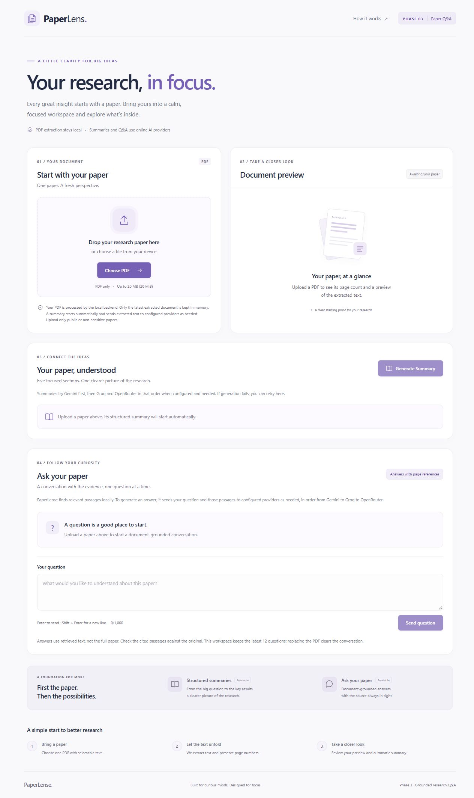

# PaperLense

**Your research, in focus.** A small research workspace built with React, Vite, FastAPI and PyMuPDF.

PaperLense uploads and validates one PDF at a time, extracts numbered page text, and displays a real preview. **Successful uploads automatically start a five-section summary.** Document-grounded Q&A uses local retrieval and validated page citations. PDF extraction and retrieval run locally. AI generation tries configured providers in order, starting with Gemini and falling back to Groq and OpenRouter. No database, authentication, OCR, vector service or agent framework is used.

See the [assessment checklist](docs/ASSESSMENT_CHECKLIST.md) for current verification and the [developer handover](docs/DEVELOPER_HANDOVER.md) for a source walkthrough. The [final audit report](docs/FINAL_AUDIT_REPORT.md) records earlier live observations and their limits.



[Mobile workspace screenshot](docs/screenshots/final-experience-mobile.jpg)

## Configure AI providers for summaries and Q&A

After cloning, optionally create the local configuration from the repository root. PDF upload and extraction work without it. If `.env` already exists, edit it instead of replacing it:

```powershell
if (-not (Test-Path -LiteralPath '.env')) {
    Copy-Item -LiteralPath '.env.example' -Destination '.env'
}
notepad.exe .env
```

Supply the keys for the providers you want enabled and restart the backend. Model variables are optional.

| Priority | Provider | Backend key | Model variable | Default model |
|---|---|---|---|---|
| 1 | Gemini | `GEMINI_API_KEY` | `GEMINI_MODEL` | `gemini-3.8-flash` |
| 2 | Groq | `GROQ_API_KEY` | `GROQ_MODEL` | `openai/gpt-oss-120b` |
| 3 | OpenRouter | `OPENROUTER_API_KEY` | `OPENROUTER_MODEL` | `nvidia/nemotron-3-ultra-550b-a55b:free` |

The backend loads the ignored repository-root `.env` using `python-dotenv`, including under WSL. Variables set in the backend process take precedence. For temporary configuration, set them in the environment of the shell that launches the backend. A PowerShell assignment is inherited by native Windows processes, while WSL processes need variables from their own environment or explicit forwarding with `WSLENV`. Keep keys out of React, `VITE_` variables, Git, logs and chat.

Gemini retains the official [`google-genai` SDK](https://googleapis.github.io/python-genai/) and [structured outputs](https://ai.google.dev/gemini-api/docs/generate-content/structured-output). Gemini model overrides need text generation, JSON schema support and `LOW` thinking. Groq uses its [chat completions API](https://console.groq.com/docs/api-reference) and [strict JSON Schema support](https://console.groq.com/docs/structured-outputs#supported-models). Its default model appears in the [public free-plan limits](https://console.groq.com/docs/rate-limits#rate-limits), while actual access and limits depend on your project. OpenRouter uses the [chat completions API](https://openrouter.ai/docs/api/api-reference/chat/send-chat-completion-request) with the exact configured model. The [default free model](https://openrouter.ai/nvidia/nemotron-3-ultra-550b-a55b:free) has no `response_format` support, so PaperLense requests JSON in its instructions and validates the result locally.

Missing keys skip the corresponding providers. On provider timeouts, connection problems, rate limits, temporary upstream errors, configuration errors or invalid output, the backend tries the next configured provider as time permits. It sends requests sequentially, with at most one application attempt per provider under a shared 90-second deadline. Provider calls may count against usage limits or incur charges. Each fallback can receive the same extracted text or retrieved excerpts as the primary provider. OpenRouter's [free model page](https://openrouter.ai/nvidia/nemotron-3-ultra-550b-a55b:free) asks users to avoid submitting confidential or personal information.

After a valid PDF upload succeeds, the app automatically requests its summary using the returned document ID. A loading message appears while the preview and **Ask your paper** stay available. Rejected uploads never start summarization. Failure retains the preview and offers **Retry summary**; retries happen only when selected. Duplicate clicks during a request are guarded. Replacing a paper clears/cancels the old summary and chat, and starts one summary request for the newly accepted document.

Each summary sends the bounded full extracted text. Q&A sends only an explicitly submitted question, an optional preceding topic question and up to four retrieved passages. The summary contains **Title & Authors and Abstract**, **Problem Statement**, **Methodology**, **Key Results** and **Conclusion**, in that order. Successful summaries and bounded chat results are cached with the current document. Repeated identical questions with the same context reuse the result without another provider call. Upload and extraction work without any API keys. Summaries and grounded AI answers require at least one configured provider.

## How grounded Q&A works

1. **Chunk:** On the first question, the backend divides extracted text into chunks of at most 1,400 characters, aiming for 220 characters of overlap. Each chunk stays on one original PDF page, including the correct numbering after blank pages. Sentence or paragraph boundaries are preferred; unusually long sentences fall back to word boundaries.
2. **Index and retrieve.** The first question builds a TF-IDF index from the current document's chunks. Its vocabulary comes from the words in those chunks. A term gets more weight if it appears often in one chunk and in fewer chunks overall. The question goes through the same filler-word removal and plural normalization. Cosine similarity compares the resulting word-weight patterns. The normal search requires at least two matching terms (one for a single-term query), 25% query-term coverage, and a score of at least 0.12. It returns up to four distinct passages in score order. A single-term definition can match without the score cutoff. Title questions use the first passage and standalone overview questions use up to three opening passages. For questions whose subject words appear in the paper, the search can add related research terms and fall back to a score of 0.05, with at most three passages. Word matching can miss paraphrases or find passages that mention a topic without answering the question.
3. **Answer.** If retrieval finds no passage, the API returns an insufficient-evidence message without calling a provider. Otherwise, each attempted provider receives the same selected evidence under instructions to use only those passages. Uploaded text and the question are untrusted data. A conservative rule includes the last topic for referential follow-ups such as “it” or “those.” Previous generated answers are never evidence.
4. **Validate and cite.** The answer JSON contains the answer, cited chunk IDs and an insufficient-evidence flag. The server rejects unknown or duplicate IDs, incomplete output, missing citations, unsupported page numbers and alternate page-reference formats. Every answer paragraph needs a citation, and every `[Page N]` must match the original page metadata of a cited retrieved chunk. Evidence Explorer lists the retrieved passages sent to the model, preserving their chunk IDs, PDF page numbers, and extracted text. It distinguishes cited passages from uncited ones. The excerpts show the inputs to the answer and are not an independent fact-check.

An explicit question such as “What does page 3 describe?” restricts retrieval to that PDF page. If the requested page is blank or missing, the API returns insufficient evidence without calling a provider.

The index is built once per document and reused. The backend retains at most 12 question/context results and one bounded topic question; React displays the latest 12 turns. A successful replacement upload evicts the whole previous record, including its index, summary and chat cache. Selecting a replacement clears the browser's history immediately and cancels its previous request; late responses cannot enter the new chat. Restarting the backend erases all document memory.

Sources validate where the model points, not whether each sentence is logically supported. Check the excerpts and original PDF. Lexical retrieval can miss synonyms, distant cross-page evidence, non-English questions, tables and equations; an insufficient-evidence response means the retrieved passages were insufficient, not that the entire paper was proved to lack an answer. The 0.12 score is a retrieval heuristic, not a confidence probability.

## Run on Windows (PowerShell)

Prerequisites: Git, Python 3.14, and Node.js 24 with npm. These are the versions used for assessment verification. Use the Ubuntu WSL backend option if native Windows cannot load PyMuPDF.

Clone once into the parent directory where you want the project:

```powershell
git clone https://github.com/senuminimsari12-code/PapaerLense.git PaperLense
Set-Location PaperLense
```

**Terminal 1: backend.** Run from the repository root:

```powershell
py -m venv backend\.venv
.\backend\.venv\Scripts\python.exe -m pip install -r backend\requirements.txt
.\backend\.venv\Scripts\python.exe -m uvicorn backend.main:app --host localhost --port 8000
```

If the environment already exists, skip the first command. The backend is at [http://localhost:8000](http://localhost:8000); interactive API documentation is at [http://localhost:8000/docs](http://localhost:8000/docs). A plain request to `/` returns 404; use `/api/health` to check the backend.

**Terminal 2: frontend.** Open another PowerShell terminal at the same repository root:

```powershell
Set-Location frontend
npm.cmd ci
npm.cmd run dev
```

Open [http://localhost:5173](http://localhost:5173). Choose a PDF with selectable text, or drop one onto the upload area. Extraction starts immediately; its summary starts automatically after acceptance. Wait for the five sections or inspect the safe error and retry when appropriate. You can type a question under **Ask your paper** during or after summarization. Enter sends a question; Shift+Enter inserts a new line. Expand **Evidence Explorer** to inspect retrieved text. Select a citation or **Open source** to display the original page in the PDF preview. Choose another PDF to replace the paper and clear its summary and conversation.

Stop each server with Ctrl+C in its terminal. For backend development, append `--reload` to the uvicorn command; a reload also resets document memory.

The commands use the virtual environment's Python directly, so activation is optional. `npm.cmd` avoids the PowerShell script wrapper.

### Ubuntu WSL backend alternative

This path assumes Ubuntu WSL and Python 3.14 are installed. From PowerShell at the repository root, create a separate Linux environment. The commands use the [PyPA pip bootstrap](https://pip.pypa.io/en/stable/installation/#standalone-zip-application) so they also work on systems without `ensurepip`.

```powershell
$linuxRoot = (wsl.exe --exec wslpath -a $PWD.Path).Trim()
wsl.exe --exec python3 -m venv --without-pip "$linuxRoot/backend/.venv-wsl"
New-Item -ItemType Directory -Path tmp -Force | Out-Null
Invoke-WebRequest 'https://bootstrap.pypa.io/pip/pip.pyz' -OutFile 'tmp\pip.pyz'
wsl.exe --exec python3 "$linuxRoot/tmp/pip.pyz" --python "$linuxRoot/backend/.venv-wsl/bin/python3" install pip -r "$linuxRoot/backend/requirements.txt"
wsl.exe --cd "$linuxRoot" --exec backend/.venv-wsl/bin/python3 -m uvicorn backend.main:app --host 127.0.0.1 --port 8000
```

After installation, start an existing environment with:

```powershell
$linuxRoot = (wsl.exe --exec wslpath -a $PWD.Path).Trim()
wsl.exe --cd "$linuxRoot" --exec backend/.venv-wsl/bin/python3 -m uvicorn backend.main:app --host 127.0.0.1 --port 8000
```

Start the Windows frontend in Terminal 2. Check the backend from PowerShell with `Invoke-RestMethod 'http://localhost:8000/api/health'` to confirm that WSL localhost forwarding works on your machine. Git ignores both virtual environments.

## Features and limits

- Responsive off-white, navy and lavender interface with a keyboard-accessible file button, drag and drop, visible focus, semantic labels, live status messages, errors and reduced-motion support.
- Actual filename, readable file size, loading state, page count, character count and a text preview after extraction succeeds.
- PDF contents are validated even when the extension or supplied MIME type is misleading. The browser checks `.pdf` filenames for convenience; the API determines the actual type from the content.
- Empty files, renamed non-PDFs, malformed/truncated/repaired PDFs, password-protected PDFs and PDFs without extractable text receive useful errors.
- Maximum PDF size: **20 MiB = 20,971,520 bytes**, labeled as 20 MB (20 MiB) in the UI. Streamed requests are also bounded, with 64 KiB allowed for multipart metadata.
- Maximum 500 pages and 2,000,000 extracted characters per document. Preview: at most 4,000 characters, including page labels and separators.
- Original page numbers are retained, including blank pages. Characters count the extracted, trimmed page text, excluding preview labels and separators.
- Exactly **one successful document** is stored globally, in a Python dictionary keyed by a UUID. The next successful upload replaces it. Failed uploads do not add records. No raw PDF bytes are kept after processing; multipart parsing may use temporary spool files, closed and removed when the request finishes.
- **Memory resets on backend restart.** Run one backend process for this local, single-user prototype. There is no authentication or user/session isolation. Retrieval runs inside the chat endpoint. The browser clears old results immediately when selecting a replacement, even if that replacement fails.
- Summaries use **all extracted page text**, with original page labels. The request is limited to **120,000 UTF-8 bytes including page labels and separators**. Larger inputs receive HTTP 413 before any provider request. No pages are silently dropped. Use a shorter paper or an explicitly labeled excerpt for this prototype; chunked summarization is not implemented. Byte counts are not token counts.
- Summary output must contain all five non-empty string fields, each at most 12,000 characters. Malformed output, provider refusals and incomplete generation are rejected. The provider output budget is 6,000 tokens. The backend has a 90-second total deadline and the browser a 110-second deadline. PaperLense can move on to another provider but only an explicit user action starts a new summary request after the whole sequence fails.
- The model is instructed to use only the supplied paper, preserve technical terms and exact reported metrics, distinguish reported findings from interpretation, and say when information is not reported. These instructions and schema validation cannot guarantee factual accuracy. Check important details against the original PDF. Figures/images are not analyzed.
- Text extraction is not a visual PDF viewer. Reading order, mathematical notation, tables and multi-column layouts may be imperfect. Scanned/image-only PDFs need OCR, which is outside this phase. Mixed documents preserve blank/image-only pages but extract text only where present.

## Architecture

```text
PaperLense/
  frontend/
    public/favicon.svg       Local vector brand asset
    src/App.jsx              State, upload and summary requests, page composition
    src/UploadCard.jsx       Drop zone, chosen-file details and upload errors
    src/DocumentPreview.jsx  Page stats and the extracted-text preview
    src/SummaryCard.jsx      Five summary sections, loading, error and retry
    src/ChatPanel.jsx        Question form, history, citation checks and retry
    src/PageSections.jsx     Fixed header, intro, feature list, steps and footer
    src/Icon.jsx             The shared inline SVG icon set
    src/fileSize.js          Byte-count formatting helper
    src/App.css              Design tokens, layout, responsive styles
    src/App.test.jsx         Upload/summary behavior and stale-state tests
    src/AutoSummary.test.jsx  Automatic initiation, Strict Mode, retries, Q&A overlap
    src/ChatPanel.test.jsx    Chat states, sources, validation and replacement
    src/main.jsx             React entry point
    index.html
    vite.config.js           React build, root .env loading, test environment
    package.json
    package-lock.json
  backend/
    main.py                  Upload/summary/chat API, limits, memory cache, CORS
    pdf_processing.py        Independent PDF validation and text extraction
    summarization.py         Five-section prompt, source budget, summary validation
    ai_providers.py          Provider order, shared deadline and failover loop
    gemini_client.py         Official Gemini SDK adapter (primary provider)
    openai_compatible_client.py  Groq and OpenRouter adapter (shared OpenAI format)
    http_error_messages.py   Provider HTTP status to safe user message mapping
    ai_errors.py             The shared ProviderError type
    retrieval.py             Page-aware chunks, local TF-IDF/cosine retrieval
    chat.py                  Grounded prompt, citations, follow-ups and cache rules
    requirements.txt         Pinned direct Python dependencies
    tests/                   In-memory PDF fixtures, processing and API tests
  docs/
    INTERVIEW_GUIDE.md        Key functions and engineering decisions
    VERIFICATION.md           Historical Phase 1 verification
    PHASE2_REPORT.md           Phase 2 verification, setup and interview guide
    PHASE3_REPORT.md           Historical Q&A verification and function guide
    PHASE4_REPORT.md           Historical hardening and requirements audit
    PHASE5_REPORT.md           Automatic summary workflow and Phase 5 verification
    DEVELOPER_HANDOVER.md      Execution flow, functions and interview questions
    ASSESSMENT_CHECKLIST.md    Final setup checks, test results and limitations
  .env.example               Backend key/model placeholders and public API URL
  .gitignore
  pytest.ini
  README.md
```

The browser builds a `FormData` request containing the PDF. FastAPI checks the multipart structure and limits the upload, then sends PDF parsing to a worker thread. `extract_pdf` checks the signature and structure, opens the bytes with PyMuPDF, and reads every page. The API assigns a random UUID, replaces the memory record, and returns only metadata and a bounded preview. React displays that response. The full numbered page text stays in the backend for summarization and local retrieval.

For summaries, React posts the document ID in the endpoint URL. FastAPI looks up its stored pages, checks for an existing summary or active request, and calls `generate_summary`. The provider layer sends a bounded full-text request with paper-only system instructions and a five-field schema. The backend validates each candidate summary with Pydantic before caching or returning it. React checks the document ID and displays the sections in a fixed order. Selecting a replacement clears the summary and aborts the old browser request. Late responses cannot overwrite the new document.

## API

### `GET /api/health`

```powershell
Invoke-RestMethod 'http://localhost:8000/api/health'
```

HTTP 200:

```json
{"status": "ok"}
```

### `POST /api/upload`

Send **exactly one** file as `multipart/form-data`, using the field `file`. Additional file or text fields are rejected. In PowerShell, `curl.exe` invokes the actual curl executable:

```powershell
curl.exe -X POST 'http://localhost:8000/api/upload' -F 'file=@C:\path\to\paper.pdf'
```

Example response shape (illustrative values; actual results depend on the PDF), HTTP 201:

```json
{
  "document_id": "e672e6b6-7e33-4c21-98db-15a9302bd6ab",
  "filename": "paper.pdf",
  "page_count": 2,
  "character_count": 1234,
  "preview": "Page 1\nExtracted text from the uploaded PDF..."
}
```

The memory entry additionally contains `pages`, for example `[{"page_number": 1, "text": "..."}, {"page_number": 2, "text": "..."}]`. This array is not returned in the preview endpoint. The React upload-success handler chains one request to the existing summary endpoint. The upload API itself still returns extraction metadata only; other API clients must call the summary endpoint explicitly.

Errors have the JSON shape `{"detail": "A useful explanation"}`:

| Status | Meaning |
| --- | --- |
| 400 | Empty file, missing/incorrect file field, extra form fields or invalid multipart data |
| 413 | File/request too large, or page/character safety limit exceeded |
| 415 | Non-PDF contents or unsupported request content type |
| 422 | Damaged PDF, password required or no extractable text |
| 500 | Unexpected failure, with a generic message; only its exception type is logged |

### `POST /api/documents/{document_id}/summary`

Use the ID returned by upload. No request body or browser API key is required:

```powershell
Invoke-RestMethod -Method Post 'http://localhost:8000/api/documents/YOUR_DOCUMENT_ID/summary'
```

HTTP 200 response shape below. These are **schema descriptions**, not a generated summary:

```json
{
  "document_id": "ID returned by the upload endpoint",
  "summary": {
    "title_authors_abstract": "Reported title and authors, plus abstract overview",
    "problem_statement": "The paper's research question and motivation",
    "methodology": "The reported approach, data and experimental design",
    "key_results": "Supported findings and exact reported metrics",
    "conclusion": "Supported conclusions and limitations"
  },
  "model": "gemini-3.8-flash",
  "source_page_count": 15,
  "source_character_count": 44609
}
```

| Summary status | Meaning |
| --- | --- |
| 404 | Unknown/expired document ID, or document replaced during generation |
| 409 | A summary request for this document is already running |
| 413 | Full extracted text exceeds the local limit, or every configured provider rejects the request for size |
| 422 | No extracted text is available |
| 429 | Provider rate/usage limit reached |
| 502 | Rejected provider request, malformed/incomplete output or model refusal |
| 503 | Missing/invalid provider configuration, provider outage or connection failure |
| 504 | Provider read/connect timeout or total deadline exceeded |

Expected operational and request-validation errors use `{"detail": "Helpful message"}`. Invalid chat input is omitted from the validation response. Logs record the provider, model, operation, attempt duration, safe error category or status, and which provider succeeds. Application logs omit raw provider errors, paper contents, questions and keys. Successful summaries are cached in the temporary document record. Replacing the document or restarting the backend removes the cache.

### `POST /api/documents/{document_id}/chat`

Send a JSON `question` of 1–1,000 characters, trimmed; no other request fields are accepted. Replace the document ID with the one returned by upload:

```powershell
$questionBody = @{ question = 'What are the main results?' } | ConvertTo-Json
Invoke-RestMethod -Method Post 'http://localhost:8000/api/documents/YOUR_DOCUMENT_ID/chat' -ContentType 'application/json' -Body $questionBody
```

HTTP 200 returns `document_id`, plain-text `answer`, `sources` (`chunk_id`, `page_number`, `excerpt`), `insufficient_evidence`, `model`, and optional `context_question`. A no-match response has an explanation, empty sources, `insufficient_evidence: true` and `model: null`. A model may also decline when matched passages do not establish an answer. A successful backup returns the same response shape and reports the model that generated the answer. Exhausting the provider sequence returns an error.

| Chat status | Meaning |
| --- | --- |
| 404 | Missing, expired or replaced document |
| 409 | Another question for this document is in progress |
| 413 | Chat request body exceeds 16 KiB, or the AI providers reject the request for size |
| 422 | Blank, missing, invalid, or longer-than-1,000-character question |
| 429 | Provider quota or rate limit |
| 502 | Rejected/malformed output, incomplete generation, refusal or invalid citations |
| 503 | Missing configuration, credential/access rejection, unavailable provider or network failure |
| 504 | Provider timeout or total request deadline |

Chat shares a 90-second backend deadline across providers. The browser request aborts after 110 seconds. A failed answer is not cached. Starting another attempt after a failure requires an explicit user action. Browser history and backend context belong to the current single-user workspace.

### Configuration and CORS

The frontend reads `VITE_API_BASE_URL` at build time. On localhost it defaults to port 8000. On a deployed site without this variable, requests use the site's own origin, which requires a reverse proxy for `/api`. For a separately hosted API, set `VITE_API_BASE_URL` to its HTTPS address before building. Vite exposes `VITE_` variables to React. Keep provider keys in the backend variables listed above.

The backend allows the two standard local Vite origins, **`http://localhost:5173`** for development and **`http://localhost:4173`** for production preview. Use those exact URLs. A URL using `127.0.0.1` is a different origin. If you intentionally change the frontend origin, update `allow_origins` in `backend/main.py` to match. CORS controls which origins can read responses in a browser. It does not authenticate requests or prevent an upload from replacing the current document. Keep the backend bound to loopback for the assessment.

## Tests and production build

From the repository root:

```powershell
.\backend\.venv\Scripts\python.exe -m pytest -q
Set-Location frontend
npm.cmd test
npm.cmd run build
```

To run the backend tests through WSL, start from the repository root:

```powershell
$linuxRoot = (wsl.exe --exec wslpath -a $PWD.Path).Trim()
wsl.exe --cd "$linuxRoot" --exec backend/.venv-wsl/bin/python3 -m pytest -q
```

Backend tests generate small PDFs in memory and cover upload, extraction, summaries, chunking, relevance, document isolation, grounded answers, citation validation, prompt injection, provider failover, cache eviction and replacement during retrieval or generation. Tests mock network calls and use dummy credentials. Frontend tests use simulated responses to verify upload and summary behavior, chat sources, keyboard input, history, loading, retries, deadlines, duplicate prevention and stale responses.

`npm.cmd run build` creates `frontend/dist`. `npm.cmd run preview` serves that build at `http://localhost:4173`. Keep the backend running on port 8000 to upload a PDF from the preview.

See the [Phase 5 report](docs/PHASE5_REPORT.md) for the automatic trigger explanation. The [Phase 4 audit and five-section presentation guide](docs/PHASE4_REPORT.md), [Phase 3 implementation guide](docs/PHASE3_REPORT.md), [Phase 2 results](docs/PHASE2_REPORT.md), [Phase 1 results](docs/VERIFICATION.md) and [Phase 1 interview guide](docs/INTERVIEW_GUIDE.md) retain their historical results.

## Troubleshooting

- **Cannot reach PaperLense:** keep both terminals running, check `/api/health`, and confirm the API address. Browser uploads time out after 120 seconds; summary/chat requests after 110 seconds. AI generation has a 90-second backend deadline.
- **Port already in use:** stop the earlier PaperLense process in its own terminal. The frontend deliberately does not choose a different port automatically.
- **`No module named backend`:** start uvicorn from the repository root, not inside `backend/`.
- **Missing Python package:** install requirements using `backend\.venv\Scripts\python.exe`, the same interpreter that runs the backend.
- **Native PDF-library import blocked by Windows application control:** use the verified Ubuntu WSL steps above. A missing-module wrapper can hide the original DLL-loading error. Native Windows execution remains unverified on this machine.
- **No text / OCR required:** use an original PDF with selectable text, or OCR it in a separate tool before uploading. Renaming an image to `.pdf` does not create a valid PDF.
- **Password or damaged PDF:** unlock/export a fresh copy in your PDF editor before uploading. PaperLense intentionally rejects PDFs the parser had to repair.
- **Document disappears after restarting:** the document and caches are held in memory. Upload the paper again.
- **AI features are not configured.** Set at least one backend provider key and restart the backend. Upload and extraction continue to work without keys.
- **AI generation is unavailable or times out.** Check the backend logs to see which providers were skipped or attempted and what status each returned. If all configured providers fail, the preview remains available and you can retry without re-uploading.
- **Not enough evidence:** ask a more specific question using terms from the paper. The local word-based retriever can miss paraphrases; it does not send the whole PDF to make up an answer.
- **Follow-up used the wrong topic:** restate the research subject in a standalone question. Follow-ups use one preceding topic question, not full conversational reasoning.
- **Provider rejects credentials or reaches a limit:** check the API project's key, model access, billing/quota and rate limits, then retry. Chat access alone does not configure this backend.
- **Summary input is too large:** this prototype accepts the full source only up to 120,000 UTF-8 bytes. Upload a shorter paper or an honestly labeled excerpt; no partial summary is silently generated.
- **Old summary disappears when selecting a new file:** expected. Even if the replacement fails validation, the old summary is removed so it cannot look like it describes the new file.
- **Long paper / complex layout:** the page, character and upload limits protect this prototype. Reading order is best-effort; compare the preview with the original.

Reference documentation: [FastAPI file uploads](https://fastapi.tiangolo.com/tutorial/request-files/), [PyMuPDF Document API](https://pymupdf.readthedocs.io/en/latest/document.html), [Vite guide](https://vite.dev/guide/).
