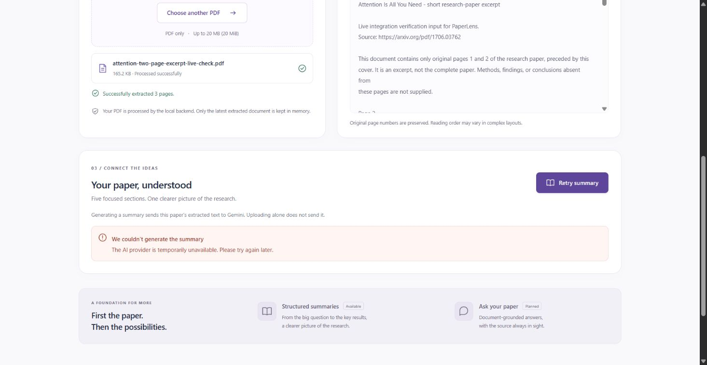

# PaperLense Phase 2: Gemini provider migration and verification

Historical Phase 2 record. This work was merged into `main` as `5a5fd8a`. See [PHASE3_REPORT.md](PHASE3_REPORT.md) for the current grounded Q&A implementation and verification; the results below describe the earlier provider migration.

Migrated and checked on 29 October 2026, starting from the existing Phase 2 commit `1be2547`. Phase 1 upload/extraction and the Phase 2 endpoint, schema, cache and frontend states are preserved. This change switches only the summary provider to Gemini; RAG/chat remains planned.

**Live verification remains incomplete.** After the user configured `GEMINI_API_KEY` in the ignored root `.env`, exactly one real summary request was made through the browser. The provider returned an unavailable/server error, surfaced as HTTP 503. No summary was returned, so all five sections could not be confirmed live. There was no retry. Automated tests use mocked traffic and are reported separately below. The key was not printed, included in a command or committed.

## 1. Files created or changed

| File | Change |
| --- | --- |
| `backend/summarization.py` | Replaces the OpenAI HTTP request/envelope parser with the official Gemini SDK, Gemini configuration and finish-reason validation |
| `backend/requirements.txt` | Adds `google-genai==2.34.0`; retains HTTPX because the SDK, transport errors and FastAPI tests still use it. There was no OpenAI SDK dependency to remove. |
| `backend/tests/test_summarization.py` | Exercises the real Gemini SDK through mocked HTTP transport; retains endpoint, source-limit, cache and race tests and adds Gemini-specific finish/part/status checks |
| `frontend/src/App.jsx` | Changes only the displayed provider name to Gemini |
| `frontend/src/App.test.jsx` | Updates the provider configuration-message fixture to `GEMINI_API_KEY` |
| `.env.example` | Replaces provider variables with `GEMINI_API_KEY` and `GEMINI_MODEL`; keeps the public frontend URL |
| `README.md` | Gemini SDK/model/key setup and accurate verification status |
| `docs/PHASE2_REPORT.md` | This updated report, including the one unsuccessful live attempt |
| `docs/screenshots/gemini-live-attempt.jpg` | Actual browser view of the safe provider-unavailable error, with no key or fabricated summary |

The API application in `backend/main.py`, extraction module, PDF validation rules, CSS, five-field response model, endpoint paths and one-document cache are unchanged by the migration. `.gitignore` already excludes `.env` files except the approved example. The real root `.env` remains local and ignored.

## 2. Request flow

1. The existing upload endpoint extracts the paper and stores numbered page text under a UUID.
2. React enables **Generate Summary** after upload succeeds, and posts that ID in the summary endpoint URL. The browser sends no API key and no copy of the paper text in this request.
3. FastAPI finds the document, returns a cached summary if present, or rejects an overlapping summary request with HTTP 409.
4. The adapter reads `GEMINI_API_KEY`, joins every page's text with its original page label and checks the source byte budget. The official SDK sends an async `models.generate_content` request to Google's Gemini Developer API, with the existing paper-only system instructions, JSON MIME type and five-field JSON schema.
5. The adapter requires exactly one candidate with a successful `STOP` finish reason. It ignores thinking parts, combines output text and validates it with the existing Pydantic model. Failures, safety blocks, truncated output, invalid JSON, missing/extra fields, blank fields, wrong types and oversized sections are rejected. Only validated content is cached and returned with source/model metadata.
6. React checks the document ID, section fields and metadata, then displays the sections in the required order. Selecting any new file clears the old summary and aborts its browser request. A late old response or error cannot replace a newer document's result or unlock its active request.

The model is instructed to preserve technical terminology and reported metrics, distinguish findings from interpretation and state when information is not reported. Output validation checks structure, not the factual truth of each statement.

## 3. Local configuration

Required for summaries: **`GEMINI_API_KEY`**, read only by the backend. Optional: **`GEMINI_MODEL`**, default **`gemini-3.8-flash`**. Google lists this as a stable text-output model with structured outputs and low thinking support in its [official model documentation](https://ai.google.dev/gemini-api/docs/models/gemini-3.8-flash). SDK usage and structured output configuration were checked against the [official SDK documentation](https://googleapis.github.io/python-genai/) and [Gemini structured-output guide](https://ai.google.dev/gemini-api/docs/generate-content/structured-output). Overrides must support these same capabilities.

Create root `.env` once from `.env.example`, replace its placeholder locally in an editor and restart the backend. Do not commit it. The backend loads it from the repository root regardless of the working directory. Existing backend process variables take precedence. Only public `VITE_` settings are exposed to React; never name a secret with that prefix.

Uploading alone does not send text to Gemini. Generating a summary sends the extracted text and can incur provider charges. The API key is supplied explicitly to the SDK and travels in its authentication header; it is not put in the URL, prompt, browser or result. The fixed service is `https://generativelanguage.googleapis.com` using the Developer API. No Google Files, provider-side cache or conversation-state API is used. Provider data handling follows the applicable Gemini API policies. SDK retries are explicitly disabled with `HttpRetryOptions(attempts=1)`; there is no fallback provider or hardcoded summary.

## 4. Exact Windows PowerShell commands

The existing WSL backend environment is used because this machine's Windows application-control policy blocks PyMuPDF's native Windows module. No security settings were changed. First-time environment creation and the alternative native Windows commands remain in [README.md](../README.md).

Configure once at the repository root. If `.env` already exists, edit it instead of copying over it:

```powershell
Set-Location 'D:\projects\PaperLense'
Copy-Item -LiteralPath '.env.example' -Destination '.env' -NoClobber
notepad.exe .env
```

Replace only the placeholder key with your real API key in the editor and save. Keep the default model unless choosing a compatible available model.

Terminal 1:

```powershell
Set-Location 'D:\projects\PaperLense'
wsl.exe --cd '/mnt/d/projects/PaperLense' --exec backend/.venv-wsl/bin/python3 -m pip install -r backend/requirements.txt
wsl.exe --cd '/mnt/d/projects/PaperLense' --exec backend/.venv-wsl/bin/python3 -m uvicorn backend.main:app --host 127.0.0.1 --port 8000
```

Terminal 2:

```powershell
Set-Location 'D:\projects\PaperLense\frontend'
npm.cmd ci
npm.cmd run dev
```

Open [http://localhost:5173](http://localhost:5173). Upload, then select **Generate Summary**. Without configuration, the app explains the missing key and keeps the extracted preview.

Tests and build, in another terminal:

```powershell
Set-Location 'D:\projects\PaperLense'
wsl.exe --cd '/mnt/d/projects/PaperLense' --exec backend/.venv-wsl/bin/python3 -m pytest -q
Set-Location frontend
npm.cmd test
npm.cmd run build
```

## 5. Test and build results

- **Backend: 84 passed**, including all 37 Phase 1 tests and 47 summary/provider tests. The pre-migration baseline was 80 backend tests. Command: `wsl --cd '/mnt/d/projects/PaperLense' --exec backend/.venv-wsl/bin/python3 -m pytest -q`.
- **Frontend: 28 passed**, including the original 14 upload/formatting tests and 14 summary tests. Command: `npm test -- --reporter=dot` from `frontend/`.
- **Production build: passed** with `npm run build` from `frontend/`.
- One existing Starlette warning remains: its HTTPX test-client adapter is deprecated. The adapter is still functional; no test is skipped or weakened to hide the warning.
- Backend tests exercise the actual Gemini SDK's request serialization and response conversion with `httpx.MockTransport`. An unmocked SDK client or real HTTP transport causes a test failure, so the automated suite cannot accidentally spend API credits. Tests also check the key is confined to the authentication header and absent from request URLs, prompts, API responses and captured logs.
- Tests cover unknown documents, complete source inclusion beyond the preview, all five sections, missing/placeholder keys, configured models, safe provider errors, rate limits, connection/read/total timeouts, malformed/incomplete/refused output, retry, caching, duplicate requests, document replacement and UTF-8 boundary sizes.
- Frontend tests cover the exact section order, disabled/loading states, duplicate prevention, error/retry, incomplete/mismatched responses, browser timeouts, old-summary removal and both late-success and late-error races while a newer request runs.
- Gemini-specific tests cover 408/504 timeouts, safety and maximum-token finish reasons, multiple candidates, fragmented JSON parts, hidden thinking parts and the one-attempt retry setting. An initial wire-format assertion expected camel-case thinking fields; inspection of the actual SDK serialization showed nested snake-case names. The assertion was corrected to check the SDK's exact serialized values, and the complete suite passed.

## 6. Real browser verification and live AI status

The running Windows frontend and WSL backend were checked through the in-app browser:

- Before upload, Generate Summary was disabled.
- For the migration live check, a short PDF was prepared from the first two pages of the public paper *Attention Is All You Need*, with a cover clearly identifying it as an excerpt. The uploaded input had **3 pages** (cover plus 2 source pages), **8,746 extracted characters**, and was about 165 KB. The fixture is kept only in ignored `tmp/`.
- Generate Summary was clicked **once**, with the real locally configured Gemini key. It returned the safe provider-unavailable error, surfaced as HTTP 503. No summary sections appeared, and the actual extracted PDF preview remained available.
- The provider was not retried. The test does not establish key/account validity, model access, or successful live generation. It must not be treated as proof that five live sections work.
- Successful five-section rendering and order remain verified with mocked responses in frontend tests. Previous Phase 2 responsive behavior is retained; the migration changes only the provider name in the frontend.



## 7. Remaining limitations

- Exactly one live request was attempted and failed with the provider-unavailable error. Successful five-section generation, key/account validity, model access and factual summary quality remain unverified. No further live request was made.
- This phase accepts complete extracted source text only up to **120,000 UTF-8 bytes**, including page labels. Longer input gets HTTP 413 before a provider request. No sampling or silent truncation is used, and chunked summarization is not implemented.
- The backend deadline remains 90 seconds. The SDK request timeout is 60,000 milliseconds and the browser deadline remains 110 seconds. Output is capped at 6,000 provider tokens including thinking. An unfinished output is rejected, not presented as a complete summary.
- Each summary section must be a non-empty string of at most 12,000 characters. These checks and the prompt reduce structural failures; they cannot prove grounding or prevent every hallucination.
- Only extracted text is summarized. Images, figures, OCR and complex-layout recovery are outside scope.
- The document and successful summary share the existing one-document, in-memory store. Both disappear on backend restart or successful replacement. The prototype still has no authentication, user isolation, persistence or public deployment hardening.
- Browser cancellation stops displaying the old request; a provider request already accepted may continue on the backend until its deadline. Server checks prevent an old result from being cached under a replacement document.
- Native Windows backend execution remains blocked on this machine; WSL execution is verified. RAG/chat remains unimplemented.

## 8. Five interview functions / code sections

| Function or section | Inputs | Outputs | Purpose in simple English |
| --- | --- | --- | --- |
| `build_paper_text(pages)` — `backend/summarization.py` | Stored list of `{page_number, text}` records | One complete page-labeled string, or a safe 413/422 error | Combines the real source and enforces the input budget. It measures UTF-8 bytes, retains blank-page labels and never silently drops pages. |
| `generate_summary(pages)` — `backend/summarization.py` | Stored pages plus backend Gemini configuration | A validated `PaperSummary` and model name, or a safe `SummaryError` | Reads the backend key, creates the official SDK client and makes one bounded async generation request. It translates SDK/API errors without leaking provider bodies, keys or paper text. |
| `PaperSummary` and `parse_summary_response(response)` — `backend/summarization.py` | Gemini SDK response containing candidates and text parts | Exactly five non-empty bounded string sections, or an error | Requires a successful `STOP`, filters thinking, combines text and applies the unchanged Pydantic checks before a summary can be displayed. Validation checks shape, not factual correctness. |
| `summarize_document(document_id)` — `backend/main.py` | The uploaded document's ID from the URL | A cached or newly generated summary response, or 404/409/provider error | Connects the existing store to the provider. It prevents overlapping calls, caches successful results, releases the busy flag on failure and detects replacement while generation runs. |
| `generateSummary()` and upload-reset logic — `frontend/src/App.jsx` | Current uploaded document ID and the user action | Loading/error/result React state | Posts the ID, validates the reply and renders sections in a fixed order. A ref prevents duplicates; an AbortController and identity check stop old requests from restoring stale results after a new selection. |

Git change control: the provider migration is a separate focused commit on `codex/gemini-provider-migration`, preserving existing commit `1be2547`. The user authorized publishing this branch and opening a PR titled **phase 3**, with main left unmerged. That PR title does not change the implementation scope: this is Phase 2 provider migration, with no RAG chatbot. Because the existing Phase 2 commit was not on remote main, the review branch also carries that prerequisite commit.
