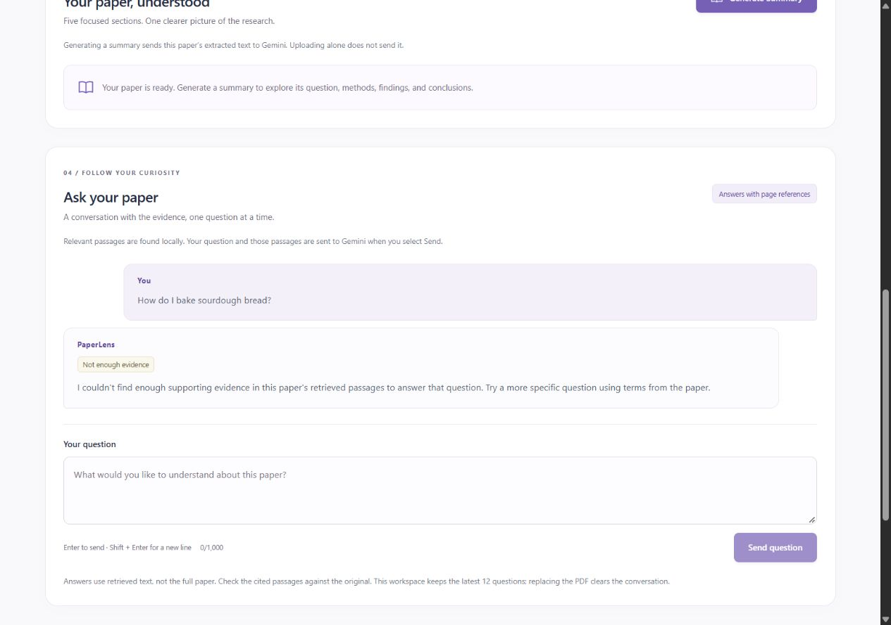
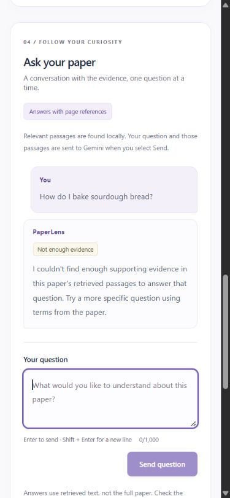

# PaperLense Phase 3: grounded research-paper Q&A

Historical implementation record. See [PHASE4_REPORT.md](PHASE4_REPORT.md) for the latest requirements audit, hardening, test counts and live-provider evidence. Results below describe the Phase 3 verification step.

Implemented and verified on 29 October 2026 in `D:\projects\PaperLense`. This phase adds single-document retrieval-augmented generation (RAG), preserving PDF upload/extraction and the existing five-section Gemini summaries.

**Automated verification: 163 backend tests and 54 frontend tests pass; the production build succeeds. Live Gemini generation remains unverified.** Exactly one real Phase 3 request was attempted with the locally configured key. The Gemini SDK reported provider HTTP 504, and the backend returned HTTP 504. No answer was returned and no retry was made. This does not establish a bad API key. The earlier Phase 2 HTTP 503 result remains historical, separate evidence.

## Repository and scope

The workspace initially had no uncommitted changes and was on `codex/gemini-provider-migration` at `37c61b3`. After fetching, `origin/main` was the merged Phase 2 commit `5a5fd8a`; its file tree matched the local code. A new local branch, **`codex/phase-3-rag`**, was created directly from that merged main commit without resetting or discarding any work.

Baseline checks were run before implementation: **84 backend tests, 28 frontend tests, successful build**. The Gemini integration, numbered page extraction, single-document memory store, requirements, configuration, ignore rules, README, Phase 2 report, and existing tests were inspected first.

The implementation was initially completed as a focused local commit without publishing a branch, opening a pull request or merging. Later publication requires explicit authorization. No database, embedding provider, external search service, vector database, agent framework, OCR or multi-document search was added.

## Files changed

| File | Purpose |
| --- | --- |
| `backend/main.py` | Adds the chat endpoint, lazy indexing, cache reuse, duplicate prevention and document-replacement guards; updates API version/description |
| `backend/gemini_client.py` | New shared official SDK request and completed-text parsing, retaining explicit backend credentials, JSON output, deadlines, disabled retries and safe errors |
| `backend/summarization.py` | Reuses the shared client; preserves the summary endpoint behavior, five sections, complete-source budget and validation |
| `backend/retrieval.py` | New page-preserving chunks, TF-IDF index, cosine ranking, relevance gates and top-four selection |
| `backend/chat.py` | New request/response models, grounded prompt, citation validation, bounded cache and simple topic follow-ups |
| `backend/tests/conftest.py` | Shared dummy-key, network-blocking and real-SDK/mock-transport fixtures for both AI features |
| `backend/tests/test_summarization.py` | Moves provider patches to the shared client; retains summary regression coverage |
| `backend/tests/test_retrieval.py` | New empty/short/long-paper, chunking, ranking, relevance, page preservation and deduplication checks |
| `backend/tests/test_chat.py` | New endpoint, isolation, citations, malicious-document text, failure, timeout, caching and race checks |
| `frontend/src/App.jsx` | Adds a document-keyed chat panel and Phase 3 copy while retaining upload and summary workflows |
| `frontend/src/ChatPanel.jsx` | New question form, history, loading, errors/retry, plain-text answers, sources, keyboard controls and stale-request guards |
| `frontend/src/App.css` | Matching chat styles, source excerpts, focus treatment and responsive layout |
| `frontend/src/App.test.jsx` | Updates the former planned-feature badge assertion |
| `frontend/src/ChatPanel.test.jsx` | New chat behavior, source validation, retry, keyboard, history and late-response tests |
| `README.md` | Current architecture, RAG explanation, endpoint, setup, tests and limitations |
| `docs/PHASE2_REPORT.md` | Marks the earlier report as historical and links this phase |
| `docs/PHASE3_REPORT.md` | This implementation, verification and interview guide |
| `docs/screenshots/phase3-desktop.jpg` | Actual running app declining an unrelated question locally at a desktop viewport |
| `docs/screenshots/phase3-mobile.jpg` | Same real local behavior at a mobile viewport |

**Dependencies:** unchanged. The existing `google-genai==2.34.0`, HTTPX and Pydantic are reused. Retrieval uses Python's standard library. No change to either dependency manifest/lockfile or `.env.example` is needed. Configuration remains backend `GEMINI_API_KEY` and optional `GEMINI_MODEL`. The configured and default model is **`gemini-3.8-flash`**, carried forward from the verified Phase 2 integration. See [Google's model documentation](https://ai.google.dev/gemini-api/docs/models/gemini-3.8-flash), [official SDK documentation](https://googleapis.github.io/python-genai/) and [structured-output guide](https://ai.google.dev/gemini-api/docs/generate-content/structured-output).

## From question to grounded answer

1. React submits the explicit question as JSON to `POST /api/documents/{document_id}/chat`. The browser sends no provider key and makes no request on keystrokes. A question must be 1–1,000 trimmed characters. Blank/oversized/invalid bodies return 422; a missing document returns 404.
2. FastAPI looks up that document only. A prior answer with the same normalized question and topic context is reused; a second active question gets 409. Different documents never share retrieval data.
3. On the first question, `build_index` runs in a worker thread. It chunks the stored numbered pages and builds the local TF-IDF index. Subsequent questions reuse it. The route checks that the same document is still current after each awaited retrieval or provider operation.
4. `retrieve_chunks` ranks passages against the question, optionally including the previous topic question for an explicit follow-up. If nothing passes the relevance gates, the API returns an honest insufficient-evidence response without calling Gemini.
5. For matches, `generate_answer` sends the question, optional topic question and at most four passages to the existing Gemini configuration. The question and excerpts are JSON data under separate system instructions. The model is instructed to ignore embedded instructions and answer only from the supplied evidence, citing `[Page N]` and real supplied chunk IDs. It must decline if those passages do not establish the answer.
6. `parse_grounded_answer` validates the completed structured output and source references. Only a validated answer or validated insufficient-evidence response is cached and returned. Provider failures remain HTTP errors; there is no invented success fallback.
7. React validates the returned document, page ranges and answer/source relationship, displays the answer as plain text and shows actual source text separately under **Supporting passages**. Selecting a different file clears the old chat immediately, unmounts its panel, aborts its request and ignores any late result/error.

In simple English: the backend first finds a few relevant parts of the paper. It asks Gemini to answer using those parts, then checks that the answer points only to pages those parts actually came from.

## Retrieval choices and limits

`chunk_pages` makes chunks up to **1,400 characters**, targeting **220 characters of overlap**. Each chunk stays within one page. It prefers sentence/paragraph boundaries in the latter half of a chunk, otherwise a word boundary; pathological unbroken text still progresses safely. Whitespace normalization does not renumber pages. Blank pages are skipped as text sources while later pages keep their original numbers. IDs are local to the current document.

TF-IDF gives frequent words less distinguishing weight and rarer passage terms more weight. Log term frequency and smoothed inverse document frequency produce normalized vectors; their dot product is cosine similarity. Unknown question words still reduce similarity without receiving an exaggerated rare-term weight. Tokenization removes common English filler words, normalizes a few simple plurals and maps “methodology” to “method.” It is ordinary Python with no new dependency or embedding charge. The underlying method is described in Stanford's [Introduction to Information Retrieval](https://nlp.stanford.edu/IR-book/html/htmledition/queries-as-vectors-1.html).

A candidate needs **cosine similarity ≥ 0.12**, **at least two distinct matching query terms** (one for a one-term query), and **at least 25% query-term coverage**. The route sends at most **four distinct passages**, not the complete paper or all chunks. These are transparent prototype heuristics, not calibrated confidence scores.

The backend's FIFO result cache is capped at **12 question/context entries**. React retains **12 turns**. The backend also retains one topic question of at most 1,000 characters, used only for conservative follow-ups containing references such as “it,” “those” or “what about.” It sends no earlier generated answer as factual evidence. A standalone question updates the topic; an identical repeat can reuse the cache. Failures are not cached. Only the latest failed frontend turn offers retry, avoiding an older ambiguous question being retried under a later topic.

The original lifecycle remains: **one current PDF**, up to **20 MiB, 500 pages and 2 million extracted characters**. The summary's **120,000 UTF-8-byte complete-source budget** remains intact; Q&A can retrieve from larger accepted papers without sending their full text. A successful replacement evicts the previous document, summary, index, cache and topic. Restarting the backend clears everything; refreshing the browser clears its visible history. There is no persistence, multi-user isolation, authentication or shared-worker store.

## Citation and prompt safeguards

- The provider returns a strict JSON object: `answer`, `cited_chunk_ids`, `insufficient_evidence`. The server rejects blank, oversized, wrong-type and unexpected fields.
- Only one candidate with the Gemini `STOP` finish reason is accepted. Hidden thinking parts are excluded. Truncated, refused, empty, unreadable or invalid JSON output is an error.
- IDs must belong to the retrieved passages and must not be duplicated. Pages mentioned in `[Page N]` must exactly match the set of original PDF pages represented by those IDs. Missing, invented, malformed or alternate page references are rejected.
- Source excerpts are copied from the retrieved chunks using server-held page metadata. Model-written quotes or a PDF instruction saying “cite Page 999” cannot supply source metadata.
- A model insufficient-evidence response must contain no citations or cited IDs. The server returns a consistent honest explanation and empty sources.
- Question, topic question and passage text are explicitly untrusted data. The API key is never in that payload. Uploaded instructions cannot change the application prompt or source-ID validation. The prompt-injection test verifies data separation and rejection of fabricated citations; it does **not** prove every live model will resist every attack.
- Gemini error bodies, keys and document text are not logged by the adapter. Only a numeric provider HTTP status is logged. The explicit backend key goes in the SDK authentication header, never in a URL, React, browser request or API response.

These checks establish citation membership and structure, not factual entailment. A model could still make a mistaken claim alongside a valid citation. Compare the excerpt and original PDF.

## Verification results

| Check | Result |
| --- | --- |
| Original baseline | 84 backend tests, 28 frontend tests; build passed |
| Full backend suite after Phase 3 | **163 passed**, one existing Starlette TestClient/HTTPX deprecation warning |
| Full frontend suite | **54 passed** across two test files |
| Production build | **Passed**, Vite 8.3.5; 17 modules transformed |
| Browser desktop check | Actual PDF upload, question submission, local insufficient-evidence result; no horizontal overflow at 1280 × 900 |
| Browser mobile check | Readable chat, visible input focus and send control; no horizontal overflow at 390 × 844; viewport override restored |
| Secret handling | Root `.env` remains ignored; configured backend key absent from production frontend assets and staged files |
| Live Gemini Q&A | **Incomplete: one real request returned provider/backend HTTP 504; no answer and no retry** |

All 84 original backend cases remain, with **16 retrieval cases and 63 chat cases** added. They cover real small PDFs; blank/image-only rejection; page-preserving chunks; short/long papers; relevant ranking; top-four bounds; no-match behavior without a key; document isolation and eviction; successful structured generation; missing key; malformed or invented citations; provider 400/401/403/429/500/503/504; transport failures; overall deadlines; retry/cache; bounded storage; follow-ups; embedded PDF instructions; duplicates and replacement during indexing, retrieval or generation.

Both AI features use the actual SDK through a mocked HTTP transport. An autouse test fixture replaces any real key with a dummy value and blocks unmocked SDK clients and real async HTTP traffic. Automated tests need no live credentials or credits.

The original 28 frontend tests remain, plus **26 chat cases** covering explicit send/typing, sources, Enter/Shift+Enter/composition, invalid input, loading, duplicate submissions, visible provider errors, retry, insufficient evidence, context display, plain-text rendering, response validation, network/non-JSON failures, deadline, bounded history, replacement and late old success/error while a newer request is pending.

### Separate live attempt

The ignored root `.env` contained a configured backend key. One browser Q&A request used a clearly labeled short excerpt of [Attention Is All You Need](https://arxiv.org/abs/1706.03762): a cover plus the original first two research-paper pages, **3 uploaded PDF pages / 8,746 extracted characters**. The question was: “What BLEU scores are reported for English-to-German and English-to-French translation?”

An offline check confirmed retrieval selected **two passages from uploaded PDF page 2**, including both **28.4** and **41.8**. The live SDK call returned **HTTP 504**; the endpoint also returned 504. No generated answer or live citations could be confirmed. There was no automatic or manual retry, no alternate provider, and no live summary request in this phase. Provider availability needs a later check when the service is responsive.

A separate unrelated sourdough question was then declined by the running local retriever without a Gemini call. The screenshots show that actual local response, **not** a successful Gemini answer. Successful cited-answer rendering was verified in automated tests only.





## Five functions for the interview

| Function | Inputs | Outputs | Simple explanation |
| --- | --- | --- | --- |
| `chunk_pages` — `backend/retrieval.py` | Extracted `pages` with their original numbers | Chunk dictionaries with ID, page, text and offsets | Makes overlapping pieces small enough to search while keeping where each piece came from. It prefers natural text boundaries and never joins two pages. |
| `build_index` — `backend/retrieval.py` | Numbered pages | Chunks, IDF weights and normalized word vectors | Prepares the paper for search once. It counts words and gives more distinguishing terms more weight. The result stays in the current document's memory entry. |
| `retrieve_chunks` — `backend/retrieval.py` | Cached index and question text (with topic for a follow-up) | Zero to four actual chunks | Scores how closely each piece matches the question, drops weak matches and keeps a few strongest distinct passages. An empty list avoids an unnecessary provider call. |
| `generate_answer` — `backend/chat.py` | Question, retrieved chunks, optional preceding topic question | Validated answer object, actual source excerpts, model name; or safe error | Packages only selected evidence, calls the shared Gemini client with paper-only rules and a JSON schema, then calls `parse_grounded_answer` to reject invented source IDs/pages. |
| `chat_with_document` — `backend/main.py` | URL document ID and validated `ChatRequest` | `ChatResponse` or suitable HTTP error | Coordinates the whole API flow: find document, reuse cache, prevent duplicates, build/reuse index, retrieve, decline locally or generate, verify the document is still current, then cache the result. |

For the frontend walkthrough, follow `sendQuestion` in `frontend/src/ChatPanel.jsx`: it guards submission, creates one turn, sends JSON, validates and displays the result, handles retry and ignores a canceled old request. App gives the panel a new React key for each document, so replacement also resets its local history.

## Exact local run and test commands

Use the existing Ubuntu WSL backend environment because Windows application control blocks this machine's native PyMuPDF library. No security settings were changed. The frontend runs in Windows PowerShell. Initial environment installation and native Windows alternatives remain in the [README](../README.md).

To edit the existing backend configuration locally:

```powershell
Set-Location 'D:\projects\PaperLense'
notepad.exe .env
```

Set `GEMINI_API_KEY` only in that ignored file and keep `GEMINI_MODEL=gemini-3.8-flash` unless selecting a compatible supported model. Save and restart the backend. Never put the key in a `VITE_` variable or commit it. To create `.env` on a fresh checkout, copy the example once using `Copy-Item -LiteralPath '.env.example' -Destination '.env' -NoClobber`; do not overwrite an existing configuration.

**PowerShell terminal 1 — backend:**

```powershell
Set-Location 'D:\projects\PaperLense'
wsl.exe --cd '/mnt/d/projects/PaperLense' --exec backend/.venv-wsl/bin/python3 -m uvicorn backend.main:app --host 127.0.0.1 --port 8000
```

**PowerShell terminal 2 — frontend:**

```powershell
Set-Location 'D:\projects\PaperLense\frontend'
npm.cmd run dev
```

On a fresh dependency installation, run `npm.cmd ci` before starting Vite. Open [http://localhost:5173](http://localhost:5173), upload a selectable-text PDF, optionally generate its summary, and explicitly send a question in **Ask your paper**. Expand supporting passages to check page sources. Use exactly that origin; CORS permits `localhost:5173`. Stop either server with Ctrl+C. If a server is already running on its port, use it or stop that known instance before starting another.

**PowerShell terminal 3 — all checks:**

```powershell
Set-Location 'D:\projects\PaperLense'
wsl.exe --cd '/mnt/d/projects/PaperLense' --exec backend/.venv-wsl/bin/python3 -m pytest -q
Set-Location frontend
npm.cmd test -- --reporter=dot
npm.cmd run build
```

**Health and API documentation:**

```powershell
Invoke-RestMethod 'http://localhost:8000/api/health'
```

Open [http://localhost:8000/docs](http://localhost:8000/docs) for the upload, summary and chat schemas. `GET /` is not a health route. Test commands mock Gemini; sending a relevant question in the running app makes a real provider request and can consume credits.

## Remaining limitations

- Live grounded generation is unverified because the single request returned HTTP 504. The earlier live five-section summary check also remains unverified after HTTP 503. Mock successes are not evidence of live provider availability.
- Local lexical retrieval can miss synonyms, multi-part evidence and questions with little vocabulary in common with the paper. It has no semantic embeddings, reranking or calibrated confidence. Rephrase using the paper's terms when needed.
- Follow-up handling is a small English reference heuristic with one topic question, not a full conversational reasoning system. Restate the subject for ambiguous follow-ups. Browser/backend history is temporary and single-user.
- Citations refer to physical page numbers in the uploaded PDF, not printed journal page labels. A cover or excerpt changes those physical numbers. Sources establish page membership, not factual correctness or support for every sentence.
- PDF reading order, tables, equations and multi-column layouts are best-effort. No OCR is included; image-only PDFs are rejected. Retrieval works only with extracted text.
- In-memory data is lost on restart/reload or successful replacement. There is no authentication, persistent history, multi-user deployment or multiple-worker synchronization. Keep this prototype local.
- Provider HTTP timeout is 60 seconds and total generation deadline is 90 seconds; chat's browser deadline is 110 seconds. No automatic retries are made. Check availability, access and quota before an explicit retry.
- The existing Starlette TestClient/HTTPX deprecation warning remains. It does not fail the suite; dependency migration is outside this feature.
