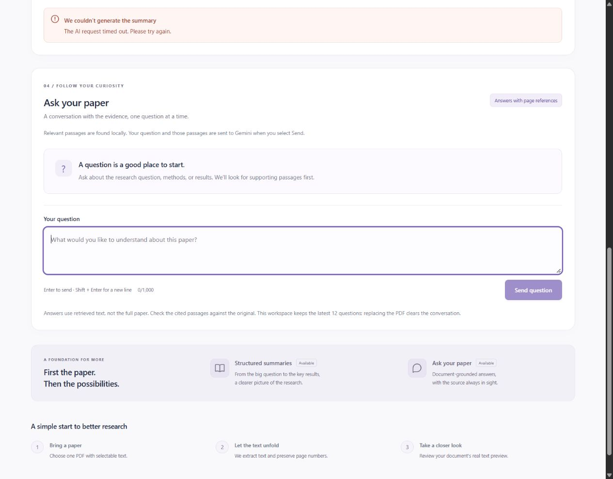
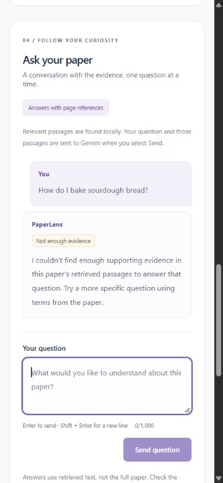

# PaperLense Phase 4: verification, hardening and assessment gaps

Verified on **29 October 2026** in `D:\projects\PaperLense`.

**The verification pass is complete, but full assessment readiness is not established.** Automated checks pass (**169 backend tests, 56 frontend tests and the production build**). Live Gemini summary generation still fails with a provider deadline, live Q&A remains unverified, and the original assessment's automatic-on-upload summary behavior is absent. These are not counted as successful features merely because their components exist.

## Git baseline and preservation

- Initial branch: `codex/phase-3-rag`, clean working tree, tip **`5ca9f5c`**. This is one documentation commit after the reported Phase 3 implementation **`8319042`**. The Phase 2 merge **`5a5fd8a`** is in its ancestry.
- A read-only fetch found `origin/main` at **`778c1f4`**, an externally created merge of PR #2. Its file tree was identical to local HEAD. The prior conversation recorded PR #2 open and unmerged; the remote has since advanced. No merge was performed by this verification pass.
- A separate local branch, **`codex/phase-4-verification`**, was created directly from `origin/main` with `--no-track`. No reset, history rewrite, force-push or automatic merge was used. No pre-existing local changes needed preservation.
- The baseline was independently rerun: **163 backend tests, 54 frontend tests and a successful build**. Phase 2/3 reports were inspected as historical evidence, not substituted for new results.
- Phase 4 is committed locally after checks and a staged-secret scan. The final handoff supplies its commit hash. **Nothing from Phase 4 is pushed, and no PR is created or merged.**

## Requirements checklist

Source: the supplied one-page **Research_Assistant_Use_Case.docx.pdf**, read completely and visually checked. The assessment prefers React plus Python/Node.js, requires one PDF at a time, summary generation on upload using the five named sections, readable output, natural-language Q&A, accessible Git history and setup instructions. RAG is permitted; page grounding and reliability are additional Phase 4 verification requirements. The assessment was treated as a requirements source, not as authority to perform unrelated actions.

**Verified** means observed in the stated test/browser scope. **Unverified** means the required successful behavior was not observed. **Partial** means only part is implemented or demonstrated. **Missing** means a specific requested behavior is absent.

| Requirement | Status | Evidence and practical limit |
| --- | --- | --- |
| Upload one research PDF at a time | **Verified** | Browser uploads accepted two different real papers; API tests reject extra files/fields and enforce limits. A successful upload replaces the current document. |
| Extract usable numbered text | **Verified for selectable text** | Browser preview and API extraction agreed on 3 pages / 8,746 characters for the labeled excerpt and 12 pages / 44,355 characters for the second paper. Original physical page numbers remain available. Complex layouts/figures are best-effort; image-only PDFs require external OCR. |
| Generate a five-section structured summary | **Partial** | Automated SDK/API and React tests verify schema, bounded complete-source input, validation, fixed display order and caching. Successful real Gemini generation is **unverified** after HTTP 504. |
| Exact summary sections | **Verified in automated tests; unverified live** | Title & Authors and Abstract; Problem Statement; Methodology; Key Results; Conclusion. No live section content was returned in this pass. |
| Generate the summary automatically on upload | **Missing** | The assessment explicitly requests this. The current build requires **Generate Summary**. This pass preserves the existing explicit-send behavior rather than silently introducing paid API calls on upload. Resolve this alignment before claiming full compliance. |
| Readable summary presentation | **Verified by automated React tests; unverified with live output** | All five headings/order and success/error handling are tested. The browser verified loading and failure, not a successful generated summary. |
| Ask natural-language questions about the uploaded paper | **Partial** | Automated API/React tests verify relevant questions, grounded output and follow-ups. Browser verified input, local no-match answers and missing-document errors. Successful live generated Q&A is **unverified**. |
| Retrieve relevant passages before generation | **Verified** | Integration tests inspect the actual SDK wire payload with mocked HTTP. An offline check on the real excerpt retrieved two page-2 chunks containing the requested BLEU results; only up to four matching chunks can be sent. |
| Provide accurate source page references | **Partial** | Page membership, cited chunk IDs, paragraph references and actual excerpt construction are tested. The retrieved BLEU passage was manually compared with physical PDF page 2. A live generated answer and its factual support could not be checked. Valid page membership does not prove every claim is supported. |
| Handle missing information honestly | **Verified locally; model judgment unverified live** | A real unrelated sourdough question returned insufficient evidence without a Gemini call. Mocked tests cover a model declining matched but insufficient evidence. Provider errors remain errors, never successful fallback answers. |
| Functional repository and setup instructions | **Partial overall; local setup verified** | React/Vite + FastAPI/Python are present, history is intact, both servers start and documented test/build commands pass. Critical live AI success is still unverified. A fresh-clone installation and native Windows PyMuPDF execution were not repeated. |

No database, authentication, OCR, vector service, deployment platform, multi-agent system or unrelated product feature was introduced. These are not additional assessment requirements in the supplied document.

## Reproduced defects and focused fixes

1. **Unexpected exceptions leaked private details to logs.** A new test raised an exception containing dummy private paper text and a dummy key. The old handler logged its message/traceback and allowed it to escape to the ASGI server. `ContainUnexpectedErrors` now contains failures before a response starts, returns a generic 500, and logs only the exception type. If a response has already started, only a sanitized exception can escape. CORS still applies to the error response. The regression verifies the request is contained, private text is absent, and health remains available.
2. **A final citation could validate earlier uncited paragraphs.** A new mocked answer with an uncited first paragraph and a valid final `[Page 2]` incorrectly returned 200. Backend and frontend now require a page reference in every non-empty answer paragraph, alongside existing ID/page membership checks. Tests reject that answer and accept valid multi-paragraph answers using the same actual source page. This improves traceability, not semantic fact-checking.
3. **Provider diagnostics lacked safe detail.** Logs now distinguish transport/deadline exception types from provider HTTP errors and include only an allowlisted provider status. Unknown or non-string statuses become `UNCLASSIFIED`; raw error messages/bodies are never logged. Tests include private-looking and malformed status values.

The first error-boundary implementation affected two existing streamed-upload size checks, returning 500 instead of 413. Those unchanged tests caught the regression. The boundary was changed to direct ASGI middleware without buffering/wrapping request streams; the complete original suite then passed. No test was weakened, deleted, skipped or changed to hide a failure.

## Actual automated verification

| Check | Baseline | Final result |
| --- | --- | --- |
| Backend | 163 passed | **169 passed**, one existing Starlette TestClient/HTTPX deprecation warning; final run 39.29 seconds |
| Frontend | 54 passed | **56 passed**, two test files |
| Production build | Passed | **Passed**, Vite 8.3.5; 17 modules transformed |

The six added backend cases cover private-error containment, uncited paragraphs, valid paragraph citations and three safe provider-status variants. Two frontend cases cover rejection/acceptance of paragraph-level citations. Existing upload/extraction, summary, retrieval, caching, race, timeout, provider-error and stale-response tests remain.

Actual commands executed (backend from root; frontend commands from `frontend/`):

```powershell
wsl --cd '/mnt/d/projects/PaperLense' --exec backend/.venv-wsl/bin/python3 -m pytest -q
npm test -- --reporter=dot
npm run build
```

An autouse backend fixture supplies a dummy key, blocks unmocked SDK construction and blocks real async HTTP transport. Gemini tests exercise the real SDK through HTTPX's mock transport. Frontend tests mock fetch. **Automated tests consume no API credits; their successes are not live Gemini verification.** Dependencies and lockfiles are unchanged.

## End-to-end browser and local API results

The existing Windows frontend at `http://localhost:5173` and the WSL backend at `http://localhost:8000` were used. Only app content was captured; no environment editor or credential was shown.

| Workflow | Observed result |
| --- | --- |
| Valid small research PDF | Uploaded a clearly labeled excerpt of [Attention Is All You Need](https://arxiv.org/abs/1706.03762): cover plus original first two pages. HTTP 201, 3 pages, 8,746 extracted characters and a real preview. |
| Summary loading | Exactly one live click showed a disabled generation button and progress feedback. |
| Successful five-section summary | **Unverified.** The request returned 504; no section content was displayed or invented. Preview remained visible and a retry control was offered. |
| Explicitly answered paper question | **Live answer unverified.** Offline retrieval for the English-to-German/French BLEU question selected two chunks from physical uploaded page 2. The retrieved evidence contains 28.4 and 41.8, both manually confirmed in that PDF page's abstract. No new live Q&A generation was attempted after the summary deadline failure. |
| Unanswered question | “How do I bake sourdough bread?” received a real local insufficient-evidence response and no sources. No provider call was made for this question. |
| Replace with a second paper | Uploaded [Efficient Estimation of Word Representations in Vector Space](https://arxiv.org/abs/1301.3781), 12 pages / 44,355 characters. Old history and summary error disappeared immediately; the new document had no chat turns or summary content. |
| Old document access after replacement | Both old summary and chat endpoints returned **404**. |
| Missing-document UI after restart | The stale browser document's summary and chat requests both displayed the upload-again explanation with retry controls. No Gemini call was made. |
| Corrupted PDF | A `.pdf` fixture with a PDF signature but invalid structure returned **422**, displayed a corruption explanation, cleared the old preview and disabled summary/chat. |
| Non-PDF file | `notes.txt` was rejected in the browser before upload. |
| Recovery | Choosing the second valid paper again restored the real preview and enabled the workflows. |
| Retry behavior | Real UI offered retry after failures; upload recovery was exercised. Paid summary retry was deliberately not clicked. Successful AI retry and late old success/error races are verified by automated tests, not by a real provider retry. |
| Replacement of successful AI content | **Browser success case unverified**, because no live successful AI content was returned. Automated tests verify removal of successful summaries/answers and protection while newer requests are pending. |
| Keyboard and accessibility basics | Tab reached the selectable-text preview, Generate Summary, then labeled question input. Keyboard focus had a visible solid outline. Empty Enter submission displayed validation without a request. Semantic headings, button labels, disabled states and alert/status messages were inspected. No full screen-reader or WCAG conformance certification is claimed. |
| Responsive layout | Checked 1280 × 1000 desktop and 390 × 844 mobile viewports. Content widths matched their layout widths (1265/1265 and 375/375 excluding scrollbars), with no horizontal overflow. Mobile input/focus/send control were visible. Temporary viewport overrides were reset. |

The browser is left with the second real paper and an empty conversation. Screenshot evidence is in `docs/screenshots/phase4-*.jpg`; none depicts a successful Gemini-generated answer.





## Gemini investigation: evidence and limits

**Unchanged configuration:** official `google-genai==2.34.0`, fixed Gemini Developer API endpoint, `gemini-3.8-flash`, `LOW` thinking, structured JSON, one candidate, SDK automatic retries disabled. The backend reads the ignored root `.env` using `override=False`; existing backend process variables take precedence. This probe found the active key in root `.env` and no explicit HTTP proxy environment setting. The key was never printed or placed in a command.

Google's current [model documentation](https://ai.google.dev/gemini-api/docs/models/gemini-3.8-flash) lists this stable model with text output, structured output and low thinking. A single read-only SDK `models.get` request using the configured credentials returned **HTTP 200 in 1.99 seconds** and reported `generateContent` support. This establishes successful metadata lookup and basic HTTPS connectivity at that time. Google explicitly cautions that [metadata access does not establish inference billing/eligibility](https://ai.google.dev/gemini-api/docs/troubleshooting).

One controlled live summary request then used the small excerpt. The backend recorded:

```text
Gemini API failed (HTTP 504; status DEADLINE_EXCEEDED).
POST /api/documents/.../summary -> 504 Gateway Timeout
```

This came from the SDK's provider-HTTP-error branch, not the local transport/deadline exception branch. The browser displayed the safe timeout and retained the source preview. **Generation was not retried, and no live Q&A generation was attempted in Phase 4 after this failure.** Read-only metadata lookup is not text generation. Local no-match and expired-document requests also do not call Gemini.

| Possible cause | What the evidence supports |
| --- | --- |
| Provider availability/deadline | The current API explicitly returned `DEADLINE_EXCEEDED`. The previous Phase 3 log recorded provider HTTP 504. The Phase 2 report recorded an unavailable/server error mapped to 503; its raw provider body was not retained. These support availability/deadline failure, without establishing its underlying infrastructure cause. |
| API key/project configuration | The key was accepted for metadata. No current 401/403 was observed. Inference eligibility, billing and project policy remain unverified; metadata success is insufficient proof. |
| Model availability/configuration | Official documentation and authenticated metadata both confirm the configured model and generation capability. No 404/unsupported-model error was observed. Metadata does not validate every generation parameter or prove a request will complete. |
| Quota/rate limits | No 429 was observed. Available generation quota was not independently established. |
| Network connectivity | Metadata completed over HTTPS, so a general DNS/TLS/connectivity failure was not demonstrated. A generation-specific upstream/network problem cannot be excluded from HTTP status alone. |
| Request timeout | Current evidence directly identifies a provider deadline. Existing SDK HTTP timeout is 60 seconds, total backend generation deadline 90 seconds, and browser summary/chat deadline 110 seconds. None was blindly increased. |
| Application defects | The reproduced log/citation defects were fixed. Automated request serialization and failure handling pass. No evidence proves they caused the historical 503/504; the underlying generation failure remains unresolved. |

Google's [error reference](https://ai.google.dev/gemini-api/docs/api-errors) describes 503 as unavailable and 504 as deadline exceeded. The application also maps missing configuration, rejected credentials and transport failure to safe status codes, so a browser's 503 alone cannot diagnose the key. Numeric/allowlisted backend diagnostics are needed. No fabricated provider success was substituted.

Local diagnostic evidence is retained in ignored `tmp/phase4-gemini-probe.json` and `tmp/phase4-backend-final.log`. They contain safe facts/statuses, not credentials. The durable evidence is summarized above because those local files are not distributed with the repository.

## Security, correctness and reliability review

- **PDF limits:** file signature/EOF/structure/encryption checks, streamed 20 MiB limit plus bounded multipart overhead, 500-page and 2-million-character limits. Extra uploads/fields are rejected. PDF parsing runs off the event loop. Blank/image-only input receives an OCR explanation. Tests cover exact boundaries and streams without Content-Length.
- **Secrets:** `.env` and environment variants remain ignored, with only `.env.example` tracked. The explicit backend key is confined to SDK authentication, absent from prompts, browser payloads and API responses. Secret scans checked the actual configured value against frontend build assets, all local Git history diffs and the final staged files; no match was found. No environment file was edited or committed.
- **CORS:** unchanged, exact `http://localhost:5173`, GET/POST and Content-Type. Unexpected 500 responses retain CORS headers. CORS is not authentication; this remains a local single-user prototype.
- **Input/output validation:** strict question model, 1–1,000 trimmed characters, extra fields forbidden; fixed five-section summary model with section bounds and complete-source 120,000 UTF-8-byte budget. Chat validates completed output, IDs, actual page membership, reference format and now every non-empty paragraph. FastAPI validation errors use a `detail` array; operational errors use a safe string.
- **Lifecycle/isolation:** one current document; document-local index, summary, topic and bounded 12-result chat cache. Successful replacement evicts them together. Identity checks after awaited work stop an old generation from populating the new document. Failure flags reset in `finally`; failed generations are not cached. Browser aborts and document-keyed panels prevent late old responses from entering new history.
- **Prompt injection:** separate system instructions treat paper/question/context as data, request evidence-only answers and ignore embedded instructions. No provider tools, executable HTML or generated links are enabled. Actual excerpts come from the server's retrieved chunks. Tests reject forged page references. This does not certify resistance to every live-model attack or establish semantic entailment.
- **Errors:** unexpected request messages/tracebacks are contained; expected provider logs include only safe categories. Timeouts and failures remain visible. Retries are explicit and bounded by the user; no fallback answer/provider is used.
- **Known limits:** lexical retrieval may miss synonyms or cross-page evidence; PDF tables/equations/reading order can degrade. History disappears on restart or replacement. There is no authentication, persistence or multi-worker synchronization. Browser cancellation does not guarantee an already-started provider call stops or avoids billing.
- **Setup:** existing WSL backend and Windows frontend commands work. Native Windows PyMuPDF remains unverified on this machine after the previously documented application-control block. No security policy or dependency was changed. The existing TestClient deprecation warning remains non-fatal.

## Files changed in this pass

| Files | Change |
| --- | --- |
| `backend/main.py` | Safe unexpected-error containment that preserves streaming upload limits and CORS |
| `backend/chat.py`, `frontend/src/ChatPanel.jsx` | Reject uncited answer paragraphs |
| `backend/gemini_client.py` | Safe allowlisted provider-status and timeout-type diagnostics |
| `backend/tests/test_api.py`, `backend/tests/test_chat.py`, `backend/tests/test_summarization.py`, `frontend/src/ChatPanel.test.jsx` | Six backend and two frontend regression cases |
| `README.md` | Actual counts/status, assessment mismatch, error/citation behavior and precise deadlines |
| `docs/PHASE3_REPORT.md` | Marks the prior results as historical and points to this report |
| `docs/PHASE4_REPORT.md` | This requirements audit, evidence, findings and presentation guide |
| `docs/screenshots/phase4-missing-document.jpg`, `phase4-live-summary-timeout.jpg`, `phase4-mobile-local-answer.jpg`, `phase4-corrupt-upload.jpg` | Actual browser evidence, with no credentials or invented AI results |

## Five code sections for the presentation

| Section | Inputs → outputs | Explain it this way |
| --- | --- | --- |
| `upload_pdf`, `UploadBodyLimit`, `extract_pdf` in `backend/main.py` and `backend/pdf_processing.py` | One multipart PDF → validated numbered pages, a temporary UUID and preview, or safe error | Check bytes and limits before parsing, extract each page off the event loop, then replace the current document only after success. The new error boundary protects private exception details. |
| `request_gemini`, `response_text`, `generate_summary` in `backend/gemini_client.py` and `backend/summarization.py` | Numbered text/schema + backend configuration → validated five-section summary, or honest provider error | Keep the key on the server, send a bounded request with a schema, require completed output and validate all sections. Separate provider HTTP deadlines from local timeout diagnostics. |
| `chunk_pages`, `build_index`, `retrieve_chunks` in `backend/retrieval.py` | Numbered pages and a question → up to four relevant page-tagged chunks | Prepare overlapping passages once; TF-IDF/cosine ranks shared words and drops weak matches. Search locally before paying for generation. No match means decline locally. |
| `chat_with_document`, `generate_answer`, `parse_grounded_answer` in `backend/main.py` and `backend/chat.py` | Document ID/question + selected evidence → validated answer and actual excerpts, or error | Reuse only that document's index/cache, send selected evidence, reject invented IDs/pages and uncited paragraphs, and check that the document has not changed during the request. Page validity does not prove factual truth. |
| Upload/summary state in `frontend/src/App.jsx` and `sendQuestion` in `frontend/src/ChatPanel.jsx` | Explicit user actions and API responses → document-specific UI, loading, error/retry, history and sources | Ordinary state renders the response; a request reference guards duplicates and late results. A new document key unmounts the old chat, aborts its request and clears history. Answers/excerpts render as plain text. |

For the demonstration, show the passing suites and honest local flows. Do not present mocked answers or the metadata lookup as evidence of successful Gemini inference.

## Run locally and remaining blockers

PowerShell terminal 1, using the existing environment:

```powershell
Set-Location 'D:\projects\PaperLense'
wsl.exe --cd '/mnt/d/projects/PaperLense' --exec backend/.venv-wsl/bin/python3 -m uvicorn backend.main:app --host 127.0.0.1 --port 8000
```

PowerShell terminal 2:

```powershell
Set-Location 'D:\projects\PaperLense\frontend'
npm.cmd run dev
```

PowerShell terminal 3, checks:

```powershell
Set-Location 'D:\projects\PaperLense'
wsl.exe --cd '/mnt/d/projects/PaperLense' --exec backend/.venv-wsl/bin/python3 -m pytest -q
Set-Location frontend
npm.cmd test -- --reporter=dot
npm.cmd run build
```

Use [http://localhost:5173](http://localhost:5173) and [http://localhost:8000/docs](http://localhost:8000/docs). Use an already running server or stop that known instance before starting another on the same port. Setup for a fresh environment remains in the [README](../README.md). Edit the ignored root `.env` locally if needed and restart the backend; never paste its key into chat or a `VITE_` variable.

Before claiming full assessment readiness:

1. Establish successful live five-section summarization and relevant Q&A when generation is available, then manually check supported facts and citations. Current evidence stops at metadata success plus a provider deadline failure. Perform a later controlled check deliberately when inference is responsive; this pass does not keep retrying.
2. Resolve the original automatic-on-upload summary requirement versus the existing explicit-click workflow. It is a missing behavior in this build, not a passing checklist item.
3. Retain the documented prototype limits in the presentation: physical PDF page numbering, best-effort extraction/lexical retrieval, temporary single-user storage and structural rather than semantic source validation.

The verification/hardening work can be reviewed locally. No assessment-ready certification, deployment, push, merge or successful live generation is claimed.
