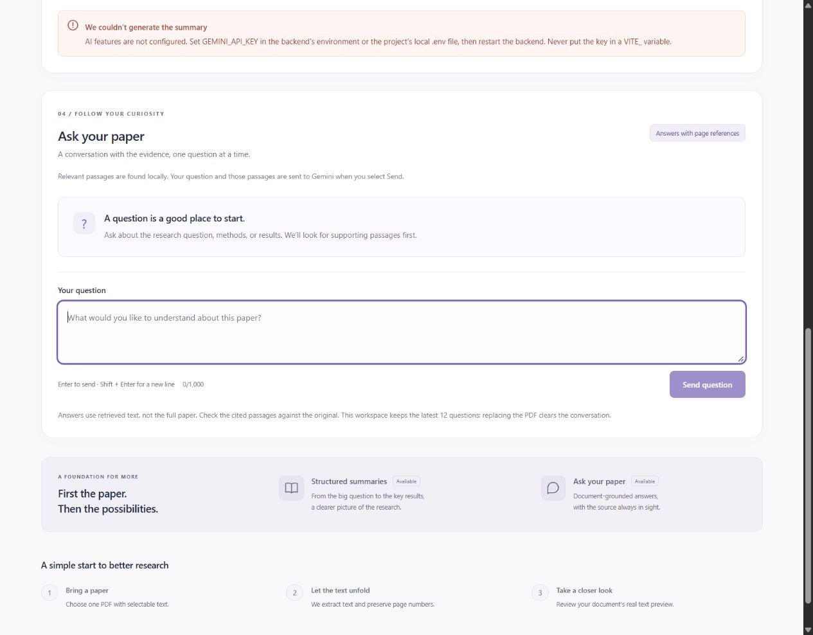
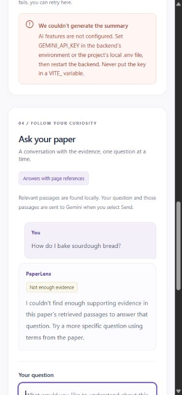

# PaperLense Phase 5: automatic summarization and compliance status

Implemented on **29 October 2026** in `D:\projects\PaperLense`.

**Automatic summary initiation after a successful upload is implemented and verified.** Final regression results are **169 backend tests passed, 73 frontend tests passed and a successful production build**. Successful live Gemini summaries and grounded Q&A remain **unverified**. No live provider call was made in this phase; full assessment readiness is not claimed.

## 1. Starting repository state

- Starting branch: **`codex/phase-4-verification`**; HEAD **`8dfbb3b`**; initial working tree **clean**. That branch still pointed to the handoff commit.
- The root, remotes, available branches and recent history were inspected. A read-only fetch found `origin/main` still at **`778c1f4`**, the Phase 3 merge. Phase 4 was one local commit above it and remained unpublished. No merge or reset was needed.
- Work continued on a new local branch, **`codex/phase-5-auto-summary`**, created from the Phase 4 commit. All existing commits were preserved.
- README, Phase 4/3 reports, the supplied original one-page assessment, upload/summary state, backend endpoint/client, configuration and relevant tests were read. The assessment explicitly requires summary generation on upload.
- Baseline checks were rerun independently: **169 backend tests, 56 frontend tests, successful build**. The historical Phase 4 report is unchanged by this phase.

## 2. Implementation and safe trigger

The change is in the existing React upload-success path, after `await response.json()`, the HTTP-success check and metadata validation. The server has already created the document before returning that response.

1. A new file selection clears the current document reference, aborts the old summary request and clears old content/loading/errors before validation. Rejected files never reach the new trigger.
2. A valid upload result must include a non-empty string document ID and the existing valid metadata/preview. The handler registers that exact result in a synchronous `currentDocument` ref and React state.
3. It calls the existing `generateSummary(result)` function, passing the accepted document explicitly. It does not await generation, so upload finishes, the preview appears and Q&A stays available.
4. That same function handles manual generation/retry. It accepts only the current document object, rejects overlapping requests and refuses to regenerate an already displayed summary for the same ID. The existing `summaryRequest` controller is set before fetch, guarding quick repeat clicks.
5. Selecting a replacement aborts/clears the old controller. Existing controller-identity checks ignore an old success, failure or `finally` block, so it cannot overwrite the new document or unlock its active request.

The trigger is tied to a validated upload response, not a filename, button click or render effect. Strict Mode can render the component again without repeating the upload event or its automatic request. Passing the response directly also avoids relying on asynchronously updated state or a previous document captured in a callback.

There is **one summary request path**, with the same validation, 110-second browser deadline, loading/error/status UI and explicit retry. The five sections retain their exact order: **Title & Authors and Abstract**, **Problem Statement**, **Methodology**, **Key Results**, **Conclusion**.

The backend API is unchanged. `/api/upload` still returns extraction metadata; the React app chains a POST to the existing `/api/documents/{document_id}/summary` endpoint. Other API clients still call that endpoint explicitly. Existing server caching, missing-document checks, duplicate-request protection, source limits, deadlines and safe error handling remain intact. No dependency or configuration change was needed.

The upload-area and summary copy now disclose the automatic transfer to Gemini. Each accepted upload can incur provider usage. Failures do not retry themselves; a deliberate **Retry summary** action requests the current document only. A browser abort cannot guarantee an already-started provider call avoids billing.

## 3. Files changed

| File | Reason |
| --- | --- |
| `frontend/src/App.jsx` | Registers the accepted document, automatically calls the existing summary function, guards document identity, tightens returned-ID validation, and updates workflow/privacy copy |
| `frontend/src/App.test.jsx` | Retains all 28 upload/summary cases; moves response setup before automatic initiation and updates expected request counts/order while preserving validation, deadlines and stale-result assertions |
| `frontend/src/ChatPanel.test.jsx` | Retains all 28 Q&A cases; mocks the additional automatic-summary request and updates indexes/counts; verifies the completed summary stays present during Q&A |
| `frontend/src/AutoSummary.test.jsx` | Adds 17 focused automatic-workflow regression cases |
| `README.md` | Explains upload-to-summary behavior, provider usage, loading/retry, unchanged API semantics and current verification status |
| `docs/PHASE5_REPORT.md` | This implementation, verification and diagnostic handoff |
| `docs/screenshots/phase5-auto-summary-desktop.jpg` | Controlled browser evidence of safe configuration failure, retained UI and keyboard focus after automatic initiation |
| `docs/screenshots/phase5-auto-summary-mobile.jpg` | Controlled mobile error/local-Q&A behavior and focus |

Backend source/tests, provider configuration, `.env.example`, `.gitignore`, dependency manifests/lockfiles and `docs/PHASE4_REPORT.md` are unchanged. The real root `.env` was not edited or copied.

## 4. Tests and actual results

The first Strict Mode automatic-initiation test failed against the original manual flow because no summary request/content appeared after upload. It passed after the implementation. All existing test scenarios remain; none was deleted, permanently skipped or weakened. Their fixtures now model the additional required request, instead of assuming the first summary begins on a manual click.

The **17 added cases** cover:

- Exactly one automatic request after upload acceptance, including Strict Mode, the returned document ID and no provider key/body in the browser's summary request.
- No requests for invalid-extension/empty files; no summary for failed or malformed upload responses, including numeric/blank IDs.
- Loading feedback and prevention of a manual duplicate while automatic generation runs.
- Safe failure, retained preview, explicit retry, double-retry prevention and no automatic retry on rerender/typing.
- Retry after replacement targeting the new document only.
- Rejected client/server replacements aborting an old request and ignoring both its late success and late failure.
- Q&A during and after a pending summary's success or failure.
- An expired-document error remaining honest without automatic retries.

Existing tests continue to verify all five headings/order, malformed summary responses, browser timeout, successful/new-document replacement, late old summary success/error while a newer request runs, chat sources/citations, duplicate chat submissions and stale chat results.

| Check | Phase 4 baseline rerun | Final Phase 5 |
| --- | --- | --- |
| Backend | 169 passed | **169 passed**, one existing Starlette TestClient/HTTPX deprecation warning; final run 24.70 seconds |
| Frontend | 56 passed | **73 passed**, three test files: 28 upload/summary + 28 Q&A + 17 automatic-workflow cases |
| Production build | Passed | **Passed**, Vite 8.3.5; 17 modules transformed |

Exact verification commands executed:

```powershell
# Repository root
wsl --cd '/mnt/d/projects/PaperLense' --exec backend/.venv-wsl/bin/python3 -m pytest -q

# frontend/ — initial failing regression, then focused and full checks
npm test -- src/AutoSummary.test.jsx -t 'Strict Mode' --reporter=dot
npm test -- src/AutoSummary.test.jsx --reporter=dot
npm test -- src/App.test.jsx --reporter=dot
npm test -- --reporter=dot
npm run build
```

The focused `-t` command selected the initial regression only; final full runs executed all 73 frontend cases with no skipped cases. Automated frontend calls use mocked API responses. The unchanged backend suite supplies a dummy key and blocks unmocked SDK clients and real async HTTP traffic. **No automated test calls live Gemini or consumes credits.**

## 5. Browser verification without paid calls

Available logs continued to show provider `504 / DEADLINE_EXCEEDED`, so a live attempt was not justified. The existing backend was stopped and a temporary backend process was started with an empty `GEMINI_API_KEY` process variable. Because dotenv uses `override=False`, that process cannot take the real key from `.env`. The same real upload and summary endpoints were used; the missing-key check returns before constructing a Gemini client. No provider response was mocked or substituted in the browser.

The temporary command, from the root, was:

```powershell
wsl --cd '/mnt/d/projects/PaperLense' --exec env GEMINI_API_KEY= backend/.venv-wsl/bin/python3 -m uvicorn backend.main:app --host 127.0.0.1 --port 8000
```

Browser observations:

| Workflow | Actual result |
| --- | --- |
| Successful upload automatically initiates summary | A real labeled research-paper excerpt uploaded with HTTP 201 (3 pages / 8,746 characters), followed by one summary POST for its returned ID, without a Generate Summary click |
| Configuration failure | The automatic request returned the real local **503 missing-key error**, retained the real preview, showed a retry control and left Q&A enabled. This is a controlled configuration error, not a new provider-outage result. |
| Explicit retry | One deliberate retry made one additional summary POST for the same current ID; it again returned the local configuration error. No provider call was made. |
| Q&A after automatic failure | A sourdough question received a real local insufficient-evidence response (HTTP 200), without calling Gemini |
| Document replacement | A second real paper uploaded (12 pages / 44,355 characters), initiated its own automatic summary request and cleared the preceding chat/history |
| Invalid PDF | A corrupted fixture returned HTTP 422 and did not initiate any summary request; summary/chat were disabled and old preview cleared |
| Desktop/mobile/focus | Checked 1280 × 1000 desktop and 390 × 844 mobile layouts. No horizontal overflow (1265/1265 and 375/375 layout/content widths). Tab reached the question field with visible focus. Temporary viewport overrides were reset. |
| Successful generated content | **Unverified live.** Loading and all-five-section success are verified by deterministic automated tests. The immediate no-key failure did not provide a sustained browser loading state or real generated sections. |

The browser session included an intervening page refresh, followed by re-uploading the excerpt. The controlled log records **three accepted uploads with three distinct IDs, three automatic summary POSTs, one extra explicit retry, one local Q&A request and one rejected upload with no follow-on summary**. There were no automatic retry loops. Evidence is retained locally in ignored `tmp/phase5-browser-no-key.log`.

The temporary backend was stopped afterward; the ordinary backend using unchanged root configuration was restored. The browser was cleared to its empty state so restoration did not trigger a new paid upload/summary. No real credential was replaced or displayed.

**Screenshot context:** these show a deliberately unconfigured test process, not failed live Gemini inference or successful generated output.





## 6. Gemini diagnostics and live status

The normal backend's configured key was confirmed present without printing it; its configured model still matches the preserved **`gemini-3.8-flash`** default. The temporary empty variable applied only to the browser-test process. No model, provider, billing setting, source budget or timeout was changed.

Reviewed settings remain: official `google-genai` SDK, `LOW` thinking, structured JSON, one candidate, **60-second SDK HTTP timeout**, **90-second total application deadline**, **110-second summary browser deadline**, and **SDK retry attempts = 1** (no automatic retry). Safe logs distinguish provider HTTP failures from transport/deadline exception types.

The available configured-backend log still contains:

```text
Gemini API failed (HTTP 504; status DEADLINE_EXCEEDED).
```

That is the provider-HTTP-error branch, not the local timeout branch. The historical Phase 4 metadata lookup returned 200, but it did not establish inference access, quota or successful generation. No current observed authentication rejection, rate-limit response or verified request-configuration defect explains this deadline. The underlying cause remains **unresolved**; it is not attributed to the key without evidence.

Google's [troubleshooting guide](https://ai.google.dev/gemini-api/docs/troubleshooting) explicitly distinguishes metadata access from inference eligibility and describes project/billing restrictions. The [generation API reference](https://ai.google.dev/api/generate-content) provides model-parameter guidance. Neither documentation nor passing mocks proves that this project's inference request will complete. No speculative provider-request change was made.

**Phase 5 live result:** no controlled live summary attempt was made because the existing diagnostics did not demonstrate recovery. No fresh metadata probe or live Q&A call was used as a pretext for inference. **Live five-section summary generation and live grounded Q&A remain unverified.** The browser's controlled 503 configuration failures are recorded separately from historical provider 503/504 failures.

**Exact next diagnostic step:** in Google AI Studio, inspect the project associated with the locally configured key for inference eligibility/access, billing status and usage/quota. Review the most recent failed generation entry for this model, if available, and retain only safe error/status/request-ID details. Do not export the credential or enable paper/prompt logging for this check. Once the project/service is demonstrably ready, upload one small known research PDF in the app, allow its single automatic attempt, record the safe result and verify the five sections against the paper. Do not repeatedly re-upload/retry, change models/billing or increase deadlines to hide the failure.

## 7. Compliance status and remaining limits

| Area | Current status |
| --- | --- |
| One PDF, usable extraction, validation and document lifecycle | Verified in automated tests and actual browser checks |
| Automatic-on-upload summary initiation | **Implemented and verified** in Strict Mode tests and the controlled browser flow |
| Five sections, fixed order, output checks, loading/error/retry and stale-response protection | Verified with mocked API/provider tests; actual browser configuration errors/retry also checked |
| Successful real five-section generation and factual accuracy | **Unverified** |
| Q&A independence during/after summarization | Verified with mocked tests; local insufficient-evidence behavior checked in the browser |
| Successful live grounded answers and citation support | **Unverified** |
| Code, history and setup documentation | Preserved; no dependency changes; README reflects the new automatic workflow |

The missing trigger identified in Phase 4 is resolved. Full assessment readiness still depends on successful live summary and Q&A verification. Existing prototype limits remain: single-user temporary memory, physical PDF page numbering, best-effort extraction and lexical retrieval, no OCR, and structural rather than semantic citation validation. No new phase or unrelated feature was started.

## 8. Final Git state

- Final branch: **`codex/phase-5-auto-summary`**, based on the intact Phase 4 commit.
- Code, tests, README, this report and two screenshots are included in one focused local commit after successful checks and a staged-secret scan. Its exact hash is supplied in the final handoff; `git log -1 --oneline` identifies the commit containing this report.
- Final working tree: **clean after commit**. No user changes, environment files, ignored logs, temporary probes or build output are included.
- **Nothing was pushed, no pull request was created, and nothing was merged or deployed.** Historical Phase 4 files and results are preserved.

Run/start commands remain in the [README](../README.md). For PowerShell, use `npm.cmd` in place of `npm` if its script wrapper is blocked; this requires no execution-policy change. Automatic generation now begins on accepted uploads, so use mocked tests for repeated checks and reserve live uploads for deliberate provider verification.
